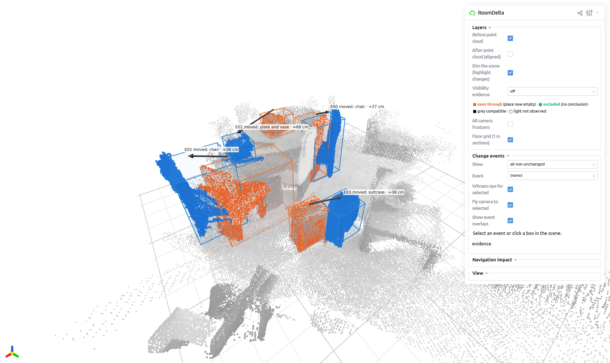
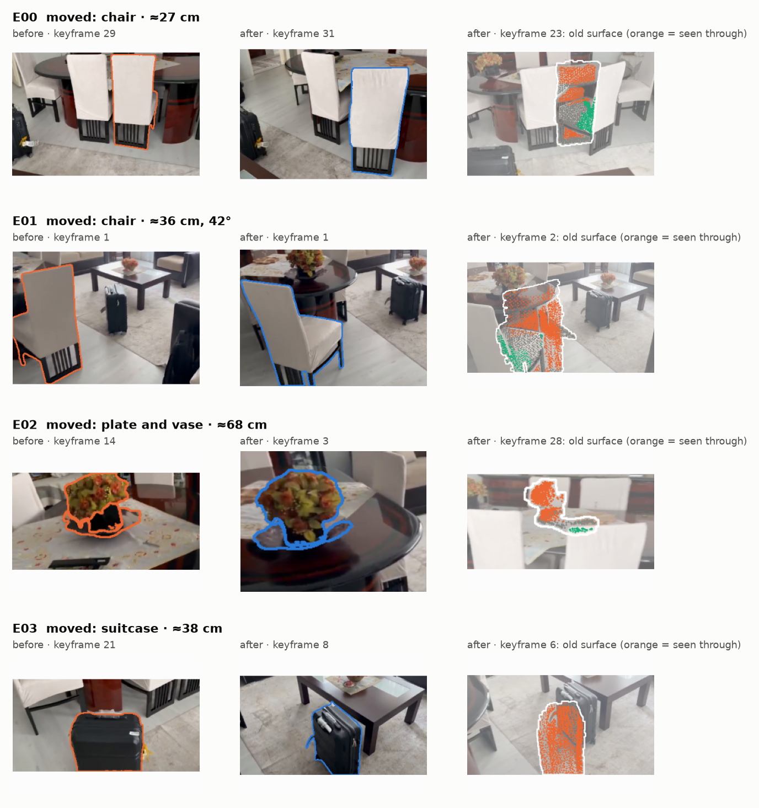
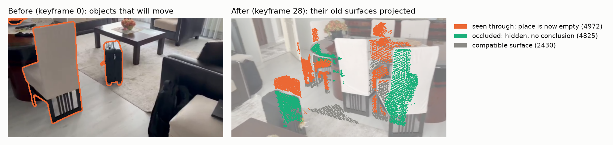
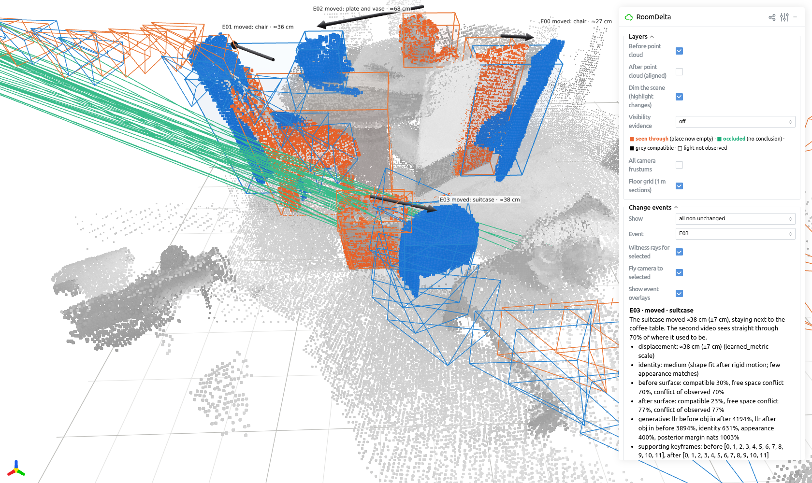
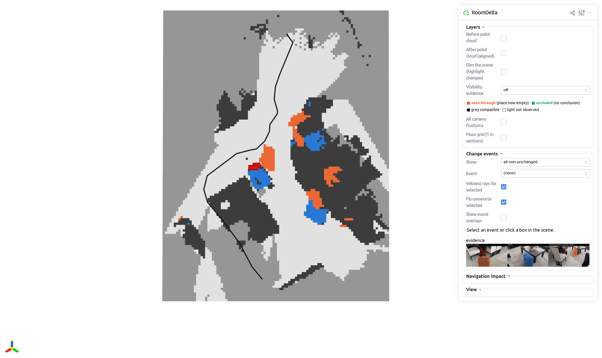

# RoomDelta

My submission for the **Humanoid Internship – Spatial AI and Navigation** challenge, *"What Changed in the Room?"*.

RoomDelta takes two phone videos of the same room, one before and one after you rearrange things, and tells you which objects moved, appeared or disappeared, and where. It rebuilds both videos as one shared 3D scene, compares every object across the two, and writes a short description of each change.



## The challenge

> Build a system that compares two phone recordings of the same small indoor area, such as a room, and identifies meaningful changes in 3D: moved furniture, new obstacles, or removed objects. Your system should identify what changed and where it happened, while distinguishing actual changes from differences in camera viewpoint, occlusion, or incomplete observations.

What it asks for, and where to find each part in this repo:

| The challenge asks for | In this repo |
|---|---|
| A shared 3D representation of the scene from both recordings | Both videos are reconstructed in one coordinate frame and saved as `scene_before.ply` and `scene_after.ply` |
| Moved, added or removed objects, identified and visualised in 3D | `events.json`, `changes.ply`, and an interactive 3D viewer (`roomdelta view`) |
| A description of the changes with labels or natural language | `report.md`, e.g. *"The suitcase moved ≈38 cm, staying next to the coffee table."* |
| Telling real changes apart from viewpoint, occlusion and missing views | If a spot was hidden or never filmed, it is not counted as a change. See [How it works](#how-it-works) |
| A working codebase | [`src/roomdelta`](src/roomdelta) |
| Clear instructions on how to run it | [Quick start](#quick-start) |
| Example inputs and outputs | [`examples/room`](examples/room) |
| A short note on design choices and trade-offs | [DESIGN.md](DESIGN.md) |

## Example

[`examples/room`](examples/room) has two 15-second iPhone videos of a living room. Between them, two dining chairs, the flower bowl on the dining table and a suitcase were moved. RoomDelta reports:

| | Change | How far |
|---|---|---|
| E00 | dining chair moved | 27 cm |
| E01 | dining chair moved | 36 cm, turned 42° |
| E02 | flower bowl moved along the dining table | 68 cm |
| E03 | suitcase moved | 38 cm |

All 18 other objects are reported as unchanged. Each change comes with an image of the object before and after, plus a view of its old spot. Orange dots mark where the camera now sees straight through to empty space:



The full output is in [`examples/room/result`](examples/room/result).

## Quick start

You need Linux (or WSL2), conda and an NVIDIA GPU. It was developed on an RTX 5070 (12 GB).

```bash
git clone https://github.com/alicaank/RoomDelta.git roomdelta
cd roomdelta
bash scripts/install.sh            # creates the conda env "roomdelta"
conda activate roomdelta
roomdelta doctor                   # checks the GPU and model downloads

roomdelta compare --before examples/room/before.mp4 --after examples/room/after.mp4 --output outputs/room
roomdelta view outputs/room        # 3D viewer at http://localhost:8080
```

The first run downloads about 3 GB of model weights. A run then takes 6–9 minutes. To use your own videos, pass their paths to `--before` and `--after`.

Tips for recording: walk slowly and move the phone sideways rather than only turning it. Film the floor and walls along with the furniture. Cover roughly the same area in both videos.

## What you get

| File | Content |
|---|---|
| `report.md` | readable summary of every change, with images |
| `events.json` | one record per object: what happened, where, how far it moved |
| `scene_before.ply`, `scene_after.ply` | the two visits as 3D point clouds in the same frame (metres) |
| `changes.ply` | only the changed objects: orange = old position, blue = new |
| `evidence/` | one image per change |

The `.ply` files open in MeshLab, CloudCompare or Blender.

## How it works

1. **Pick frames.** About 32 sharp, well-spread frames are taken from each video.
2. **Build one 3D scene.** [Depth Anything 3](https://github.com/ByteDance-Seed/Depth-Anything-3) estimates the camera positions of both videos together, so they share one coordinate frame. Depth is estimated for each video from its own frames, so a moved object in one video does not affect the other. A metric depth model sets the scale in metres.
3. **Find objects.** Grounding DINO detects everyday objects and SAM 2.1 cuts them out. The object masks are lifted into 3D and tracked through each video.
4. **Decide what changed.** For each object there are a few possible explanations: it stayed, it moved, it was removed, or it is new. Each one predicts what the other video's camera should have seen. RoomDelta checks those predictions against the depth the camera actually measured and keeps the best explanation.
5. **Report it.** It writes the descriptions, images and 3D files.

The checking step is what separates real changes from viewpoint and occlusion:

- If something in front blocks the view, every explanation predicts the same blocker, so that view tells us nothing about the object.
- If the second video never filmed a spot, nothing is concluded about it.
- A change is only reported when it is clearly more likely than the alternatives.

In the image below, the old positions of the moved objects are drawn into one frame of the second video. Orange means the camera sees through them, so the spot is now empty. Green means something in front blocks the view, so there is no conclusion:



More detail, and the things that didn't work, are in [DESIGN.md](DESIGN.md).

## Viewer

`roomdelta view outputs/room` opens the 3D scene in the browser. You can:

- switch between before and after;
- click a change to see its description and evidence;
- colour every point by what the other video saw there.

It also has a simple navigation check for robots: it draws a floor map and shows whether a change now blocks the path walked in the first video. In the example, the moved suitcase blocks it.

| A selected change | Floor map and the old walking route |
|---|---|
|  |  |

## Results

The person who recorded the example confirmed the four moves above, so RoomDelta found every change with no false alarms. I also ran tests that need no labels:

| Test | Expected | Result |
|---|---|---|
| before vs. after | 4 moves | 4 moves |
| after vs. before (swapped) | same 4 moves | same 4 moves |
| a video against itself (different frames) | no changes | no changes |
| with a larger 3D model, no tuning | 4 moves | 4 moves |

For comparison, a plain point-cloud diff on the same data reports 44 changed regions. Most of the points it calls missing were only hidden, or not filmed, in the other video.

To rerun: `python evaluation/sanity.py`, `python evaluation/baselines.py outputs/room`, `pytest tests`.

## Repository layout

```
src/roomdelta/    the code (pipeline.py runs everything; cli.py is the command line)
examples/room/    example videos and their output
evaluation/       the tests and baseline above
docs/             images used in this README
scripts/          install script
DESIGN.md         design choices and trade-offs
```

## License

Apache-2.0. The models used keep their own licenses, listed in [THIRD_PARTY_NOTICES.md](THIRD_PARTY_NOTICES.md).
