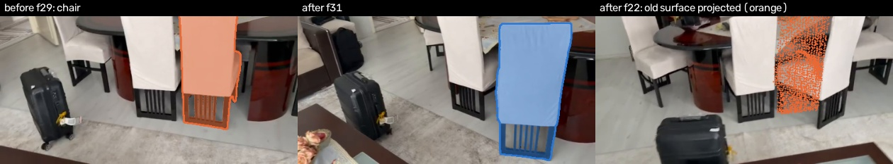
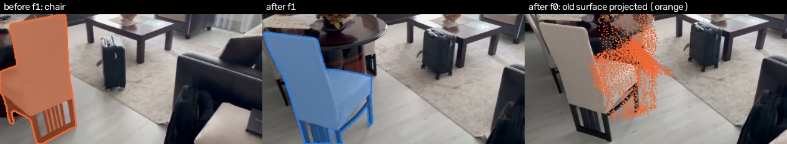
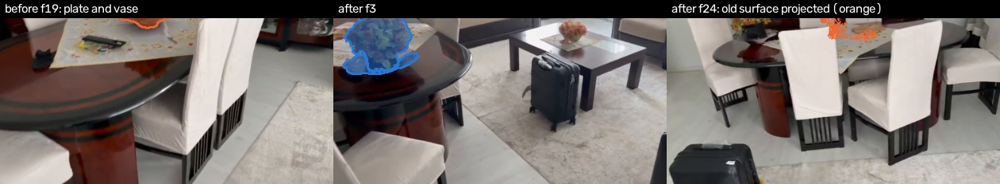
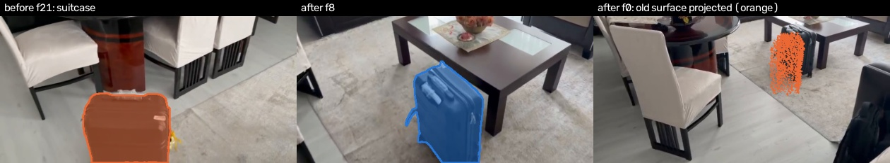

# What changed

Compared `before.mp4` with `after.mp4` (32 frames each).

- Alignment of the two videos: good, typical mismatch ≈3 cm over 425 matched frame pairs.
- Scale: estimated by a metric depth model, ±5% (this puts the camera 1.31 m above the floor).

## Changes

### E00: chair moved
The chair moved ≈27 cm (±6 cm), staying next to the dining table. The second video sees straight through 33% of where it used to be.

- Note: The shape is nearly symmetric, so its rotation is not reported.

### E01: chair moved
The chair moved ≈36 cm (±7 cm) and turned about 42°, staying next to the dining table. The second video sees straight through 41% of where it used to be.

### E02: plate and vase moved
The plate and vase moved ≈68 cm (±7 cm) along the dining table. The second video sees straight through 86% of where it used to be.

- Note: The shape is nearly symmetric, so its rotation is not reported.
- Note: 2 detected parts moved together and are reported as one change.

### E03: suitcase moved
The suitcase moved ≈38 cm (±7 cm), staying next to the coffee table. The second video sees straight through 70% of where it used to be.

- Note: The shape is nearly symmetric, so its rotation is not reported.

## Is the old walking route still clear?

The route is the path walked in the first video. The robot is modelled as a disc of 0.27 m radius (0.22 m plus 0.05 m clearance). This checks the footprint only, not full-body collisions.

- The suitcase (E03) now stands on the route.
- 32% of the route's footprint was not filmed in the second video. That part is unknown, not blocked.

How the answer depends on the robot's size:

| robot radius (m) | changes on the route |
|---|---|
| 0.15 | none |
| 0.20 | suitcase (E03) |
| 0.25 | suitcase (E03) |
| 0.30 | suitcase (E03) |
| 0.35 | suitcase (E03) |

## Unchanged

18 objects: armchair, book, chair, flowers, plate, sofa, suitcase, table.
